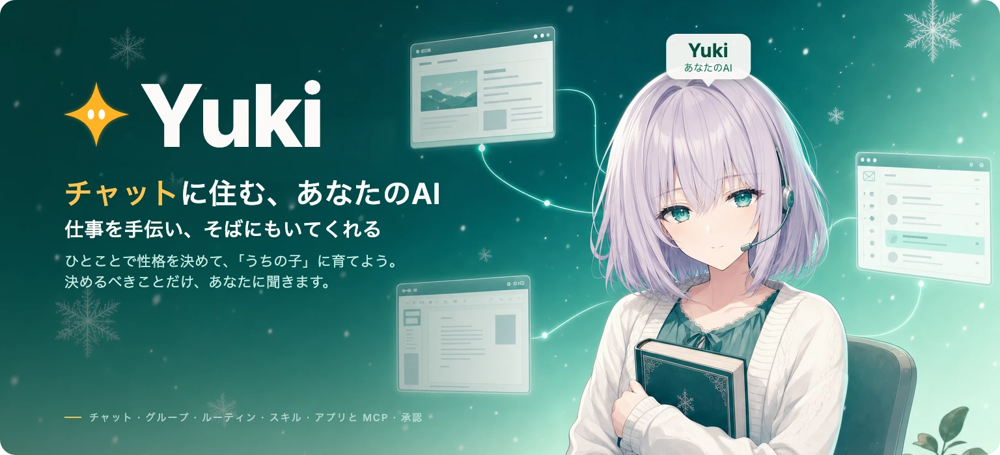
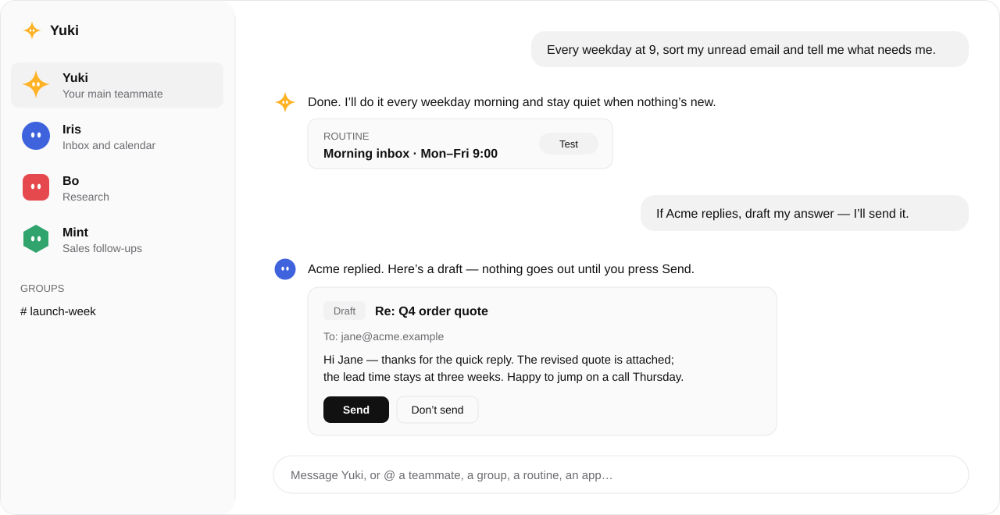

<p align="center">
  <a href="https://yukilab.si"></a>
</p>

<p align="center">
  <a href="README.md">English</a> · <a href="README.zh-CN.md">简体中文</a> · <strong>日本語</strong>
</p>

<p align="center">
  <strong><a href="https://yukilab.si">yukilab.si で試す</a></strong> &nbsp;·&nbsp; <a href="#クイックスタート">自分で動かす</a> &nbsp;·&nbsp; <a href="#yuki-にできること">できること</a> &nbsp;·&nbsp; <a href="#コア版とホスト版">コア版とホスト版</a>
</p>

Yuki は**チャットに住む、あなたのAI。仕事を手伝い、そばにもいてくれます**。開けば、もう Yuki がいます。どんな子にするかはひとことで決めて、あとはあなたのペースで育ててください。手が足りなければメンバーを増やしてグループに入れると、会話の中で仕事を引き継ぎ合います。判断が必要なときだけあなたに聞き、あなたが OK するまで、あなたの名前で何かを送ることはありません。

このリポジトリは Yuki のソース公開コアです。ひとり用で、あなた自身のマシンで動き、Yuki コミュニティライセンスで公開しています。

<picture>
  <source media="(prefers-color-scheme: dark)" srcset="assets/yuki/chat-dark.svg">
  
</picture>

## Yuki にできること

<table>
<tr>
<td width="50%" valign="top">

**設定画面はいらない、話すだけ**<br>
設定フォームはありません。最初に話したことが、そのメンバーの役割になります。変えたいときも、そう伝えるだけ。

</td>
<td width="50%" valign="top">

**メンバーとグループ**<br>
グループは 2〜6 人。`@` でメンバー、グループ、ルーティン、アプリを呼べます。引き継ぎは会話の中で行われ、あなたにも見えます。

</td>
</tr>
<tr>
<td valign="top">

**ルーティン**<br>
「平日の朝 9 時に…」「メールが届いたら…」。メンバーのカードから一時停止・テスト・編集ができます。新しいことがなければ、静かにしています。

</td>
<td valign="top">

**スキル**<br>
やり方をひとことで保存できます。いま一緒にやったことから、Yuki に覚えさせることもできます。

</td>
</tr>
<tr>
<td valign="top">

**アプリと MCP**<br>
Gmail、Google カレンダー、自分のメールボックス、Slack、そしてあなたのマシン上のものも含むあらゆる MCP サーバー。一度つなげば、すべてのメンバーが使えます。

</td>
<td valign="top">

**大事なことは、あなたが承認**<br>
今回だけ許可、常に許可、拒否。メールと Slack のメッセージは、あなたが送信を押すまで下書きのまま。アクション審査が、あなた自身のルールで一歩ずつ確認します。

</td>
</tr>
</table>

会話はあなた自身のデータベース（内蔵の PGlite、またはあなたの Postgres）に保存されます。秘密情報はあなた自身の鍵で封をされ、モデルに見せることはありません。

## コア版とホスト版

|  | コア版（このリポジトリ） | [ホスト版](https://yukilab.si) |
|:--|:--|:--|
| チャット、メンバー、グループ、ルーティン、スキル、アプリ、承認 | ✓ | ✓ |
| メンバーが作業するパソコン | ✓ 専用コンテナ、あなたのマシン上 | 近日公開：クラウドのパソコン |
| チームと共有スペース | — | 近日公開 |

エンジンには以前の設計（デスクトップアカウント）のコードが一部残っていますが、アプリからはもう使われていません。今後のリリースで取り除きます。

---

## クイックスタート

Node 22 以上と pnpm 11、それにモデル提供元（OpenAI、Anthropic、Google のいずれか）の API キーが必要です。

```sh
git clone https://github.com/caspianchan31/yuki.git
cd yuki
pnpm install
pnpm --dir apps/web install
cp .env.example .env
```

自分専用の鍵を 2 つ作り、リポジトリの外に置きます：

```sh
mkdir -p ~/.yuki
openssl rand -base64 32 > ~/.yuki/credential.key && chmod 600 ~/.yuki/credential.key
openssl rand -base64 32   # 下の TOKEN_ENCRYPTION_KEY に貼り付け
```

`.env` に次を設定します：

```sh
WORKSPACE_MODE=live
AGENT_BACKEND=model
MODEL=openai/gpt-5            # または anthropic/<model>、google/<model>
OPENAI_API_KEY=sk-...         # そのモデル提供元のキー（ANTHROPIC_API_KEY、GOOGLE_API_KEY）
TOKEN_ENCRYPTION_KEY=...      # 上で表示された値
CREDENTIAL_KEY_FILE=/Users/you/.yuki/credential.key   # そのファイルのフルパス
```

API とアプリを、2 つのターミナルで起動します：

```sh
pnpm dev                      # API: http://localhost:8787
pnpm --dir apps/web dev       # アプリ: http://localhost:5173
```

http://localhost:5173 を開きます。初回は、ユーザー名、パスワード、そして API のターミナルに表示されたセットアップコードでアカウントを作ります。あとは Yuki に話しかけてみてください。

モデルのキーがなくても、`cp .env.example .env` だけで、架空のデータと台本どおりに答える Yuki のサンプルワークスペースが起動します。

### docker compose で動かす（専用パソコン付き）

コマンドひとつで、Yuki のサービスと、別の**パソコン**コンテナが起動します。メンバーはそこでコマンドを実行し、ファイルを置き、ウェブを見ます。作業はそのパソコンの中だけで、あなたのマシンには触れません。画面をリアルタイムで見たり、操作を引き継いで返したりでき、誰も使っていないときは自動で一時停止します。Compose プラグイン付きの Docker と、約 3 GB の空きメモリが必要です。

```sh
cp .env.example .env
# .env を編集：MODEL、モデル提供元の API キー、OPENMUSE_ADMIN_USERNAME と OPENMUSE_ADMIN_PASSWORD
docker compose up -d --build   # そのあと http://localhost:8787 を開く
```

メモリ上限、ポート、一時停止までの時間は `.env` で変えられます。詳細、制限、データの置き場所は [docs/computer-container.md](docs/computer-container.md)（英語）をご覧ください。

### アプリをつなぐ

アプリの画面表示は、現在中国語です。かっこ内は日本語訳です。

- **MCP サーバー**：设置（設定）→ 连接的应用（連携アプリ）→ 添加自定义 MCP 服务（カスタム MCP サービスを追加）で、サーバーのアドレスと、必要ならアクセストークンを入力します。あなたのマシンやネットワーク上のサーバー（`http://localhost:…`）も使えます。
- **自分のメールボックス**：⌘K → 凭据（認証情報）→ 添加发信邮箱（送信用メールを追加）。SMTP、受信もするなら IMAP を設定します。
- **Gmail と Google カレンダー**：Google OAuth のウェブクライアントを作り、`GOOGLE_CLIENT_ID` と `GOOGLE_CLIENT_SECRET` を設定し、リダイレクト URI に `http://localhost:8787/api/google/callback` を登録します。
- **Slack**：自分の Slack アプリを作り、`SLACK_CLIENT_ID` と `SLACK_CLIENT_SECRET` を設定します。手順はすぐ下にあります。

<details>
<summary><b>Slack をつなぐ手順</b></summary>

Slack には自分のアプリが必要です（作るのは一度だけ）。その後、设置 → 连接的应用 → Slack → 连接（接続）を押すと Slack に移動し、許可すると接続済みの状態で戻ってきます。

1. <https://api.slack.com/apps> を開き、**Create New App** → **From scratch**。名前を付けて、ワークスペースを選びます。
2. **OAuth & Permissions** → **Redirect URLs** に `<PUBLIC_API_URL>/api/slack/callback`（ローカルなら `http://localhost:8787/api/slack/callback`）を追加して保存します。
3. 同じページの **Bot Token Scopes** に、`channels:read`、`groups:read`、`channels:history`、`groups:history`、`users:read`、`chat:write`、`chat:write.public` を追加します。
4. **Basic Information** で **Client ID** と **Client Secret** をコピーし、`.env` の `SLACK_CLIENT_ID` と `SLACK_CLIENT_SECRET` に設定します。`TOKEN_ENCRYPTION_KEY` も設定されているか確認して、再起動します。
5. Slack で、読ませたいチャンネルごとにアプリを招待します（`/invite @your-app`）。参加しているチャンネルしか読めません。メンバーは読んで下書きを作るだけで、メッセージはあなたが送信を押したときにだけ送られます。

</details>

## ライセンス

[Yuki コミュニティライセンス 1.0](LICENSE)（本文は英語）：自分や自分の組織の中で使う、改変する、動かすのは自由です。他の人向けにホスティングサービスとして提供することはできません。各バージョンは公開から 2 年後に MIT ライセンスになります。サードパーティの表記：[THIRD_PARTY_NOTICES.md](THIRD_PARTY_NOTICES.md)。
