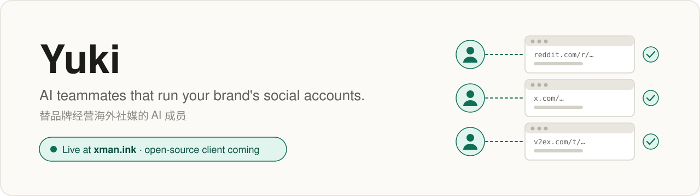

<picture>
  <source media="(prefers-color-scheme: dark)" srcset="assets/yuki-banner-dark.svg">
  
</picture>

**Yuki** is a team of AI teammates that run a brand's social accounts. You give them work in a chat, the way you would with coworkers. Each one works in its own cloud desktop and comes back with a link for everything it did.

**Yuki** 是一队替品牌经营海外社媒的 AI 成员。你像跟同事说话一样在聊天里派活；每个成员在自己的云电脑里干活，做完的每件事都带着链接回来。

### How it works

- **One teammate, one computer.** Every teammate has its own cloud desktop, browser and logins, never shared with another account.
- **Every action has a link.** When a teammate posts or replies, its report carries the link to that exact post. If it can't produce one, it says so.
- **You keep the keys.** Passwords, 2FA codes and passkeys are typed by you, in the teammate's desktop. The AI never sees them.
- **It acts on its own.** Teammates pick up work and finish it, and only come to you when there is a real decision to make.

### What's in Yuki

| Part | What it is | Status |
|:---|:---|:---|
| Yuki hosted | Everything below, run for you at [xman.ink](https://xman.ink). Billed per store. | Live, by invitation |
| Yuki client | Chat, teammates, groups, routines, reports and the agent engine. Open source and self-hostable. | Coming to this repo |
| Yuki desktop service | A cloud desktop, browser and saved logins for each teammate. Billed per account. | Coming for self-hosters |

Star or watch this repo to hear when the client lands.

### Built on

Yuki started as a fork of [OpenMuse](https://github.com/CopilotKit/openmuse) by CopilotKit (MIT). It has since grown multi-tenant workspaces, a cloud desktop per account and its own operations loop. The single-user, self-hosted version lives on as [openmuse-standalone](https://github.com/caspianchan31/openmuse-standalone).
