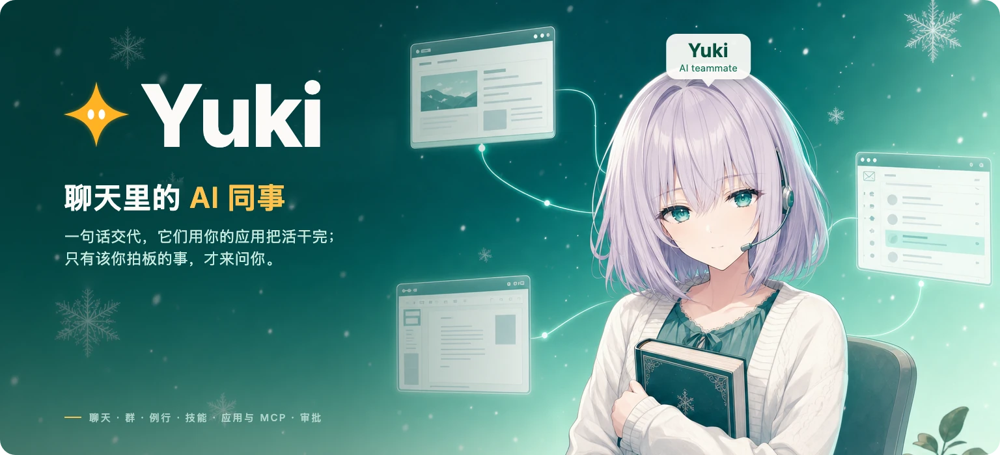

<p align="center">
  <a href="https://yukilab.si"></a>
</p>

<p align="center">
  <a href="README.md">English</a> · <strong>简体中文</strong>
</p>

<p align="center">
  <strong><a href="https://yukilab.si">在 yukilab.si 试用</a></strong> &nbsp;·&nbsp; <a href="#快速上手">自己部署</a> &nbsp;·&nbsp; <a href="#yuki-能做什么">能做什么</a> &nbsp;·&nbsp; <a href="#核心版和托管版">核心版和托管版</a>
</p>

Yuki 是**聊天里的 AI 同事**。打开就有 Yuki，第一句话告诉它做什么。需要帮手就加成员，拉进群里，它们在对话里互相交接。要你拍板时才来找你；没有你点头，不会以你的名义发出任何东西。

这个仓库是 Yuki 的源码公开核心：单用户，跑在你自己的电脑上，采用 Yuki 社区许可证。

<picture>
  <source media="(prefers-color-scheme: dark)" srcset="assets/yuki/chat-dark.svg">
  
</picture>

## Yuki 能做什么

<table>
<tr>
<td width="50%" valign="top">

**说话就行，不用配置**<br>
没有设置表单。第一句话就是成员的职责，想改就跟它说。

</td>
<td width="50%" valign="top">

**成员和群**<br>
群 2 到 6 个成员。`@` 可以指成员、群、例行、应用。交接在对话里，看得见。

</td>
</tr>
<tr>
<td valign="top">

**例行**<br>
「每个工作日 9 点……」「来信时……」。在成员卡上暂停、测试、修改。没有新情况就安静。

</td>
<td valign="top">

**技能**<br>
一句话存下一种做法，或者让 Yuki 从刚和你一起做完的事里学会。

</td>
</tr>
<tr>
<td valign="top">

**应用和 MCP**<br>
Gmail、谷歌日历、自己的邮箱、Slack，以及任何 MCP 服务，包括跑在你自己电脑上的。连一次，所有成员都能用。

</td>
<td valign="top">

**要紧的事你来批**<br>
允许一次、总是允许、拒绝。邮件和 Slack 消息都是草稿，你点发送才发。动作审查按你自己的规则检查每一步。

</td>
</tr>
</table>

对话存在你自己的数据库里（内置 PGlite，或你的 Postgres）。密钥用你自己的钥匙加密，模型永远看不到。

## 核心版和托管版

|  | 核心版（本仓库） | [托管版](https://yukilab.si) |
|:--|:--|:--|
| 聊天、成员、群、例行、技能、应用、审批 | ✓ | ✓ |
| 给成员干活用的电脑 | ✓ 独立容器，跑在你的机器上 | 即将推出：云电脑 |
| 团队、共享空间 | — | 即将推出 |

引擎里还留着一些早期设计（桌面账号）的代码，应用里已经用不到，后续版本会清掉。

---

## 快速上手

需要 Node 22 以上、pnpm 11，以及一个模型服务商的 API 密钥（OpenAI、Anthropic 或 Google）。

```sh
git clone https://github.com/caspianchan31/yuki.git
cd yuki
pnpm install
pnpm --dir apps/web install
cp .env.example .env
```

生成两把你自己的钥匙，放在仓库外面：

```sh
mkdir -p ~/.yuki
openssl rand -base64 32 > ~/.yuki/credential.key && chmod 600 ~/.yuki/credential.key
openssl rand -base64 32   # 输出的值填到下面的 TOKEN_ENCRYPTION_KEY
```

在 `.env` 里设置：

```sh
WORKSPACE_MODE=live
AGENT_BACKEND=model
MODEL=openai/gpt-5            # 或 anthropic/<模型>、google/<模型>
OPENAI_API_KEY=sk-...         # 对应服务商的密钥（ANTHROPIC_API_KEY、GOOGLE_API_KEY）
TOKEN_ENCRYPTION_KEY=...      # 上面输出的值
CREDENTIAL_KEY_FILE=/Users/you/.yuki/credential.key   # 写完整路径
```

开两个终端，分别启动服务端和网页：

```sh
pnpm dev                      # 服务端 http://localhost:8787
pnpm --dir apps/web dev       # 网页 http://localhost:5173
```

打开 http://localhost:5173。第一次进来，用用户名、密码和服务端终端里打印的设置码建好你的账号，然后跟 Yuki 打个招呼。

没有模型密钥时，只做 `cp .env.example .env` 也能启动：一个示例工作区，数据是虚构的，Yuki 按脚本回答。

### 用 docker compose 启动（带一台独立的电脑）

一条命令同时启动 Yuki 服务和一个单独的**电脑**容器：队友在里面跑命令、存文件、上网；他们只在那台电脑里干活，不碰你的机器。你能看它的实时画面、接手、再交还；没人用时它自己暂停。需要 Docker（含 Compose）和约 3 GB 空闲内存。

```sh
cp .env.example .env
# 编辑 .env：MODEL、模型服务商的密钥、OPENMUSE_ADMIN_USERNAME 和 OPENMUSE_ADMIN_PASSWORD
docker compose up -d --build   # 然后打开 http://localhost:8787
```

内存上限、端口、闲置暂停时间都在 `.env` 里改。详情、限制和数据存放位置见 [docs/computer-container.md](docs/computer-container.md)（英文）。

### 连接应用

- **MCP 服务**：设置 → 连接的应用 → 添加自定义 MCP 服务，填地址，需要的话填访问令牌。跑在你自己电脑或内网上的服务（`http://localhost:…`）也可以。
- **自己的邮箱**：⌘K → 凭据 → 添加发信邮箱（SMTP，要收信再填 IMAP）。
- **Gmail 和谷歌日历**：建一个 Google OAuth 网页客户端，设置 `GOOGLE_CLIENT_ID`、`GOOGLE_CLIENT_SECRET`，回调地址登记为 `http://localhost:8787/api/google/callback`。
- **Slack**：先建一个自己的 Slack 应用，再设置 `SLACK_CLIENT_ID`、`SLACK_CLIENT_SECRET`，步骤见下面。

<details>
<summary><b>连接 Slack：一步步来</b></summary>

Slack 要用你自己建的应用，建一次就行。之后在 设置 → 连接的应用 → Slack 点「连接」，去 Slack 允许一下就回来，已经连好。

1. 打开 <https://api.slack.com/apps> → **Create New App** → **From scratch**，起名并选你的工作区。
2. **OAuth & Permissions** → **Redirect URLs**，添加 `<PUBLIC_API_URL>/api/slack/callback`（本机安装就是 `http://localhost:8787/api/slack/callback`），保存。
3. 同一页的 **Bot Token Scopes** 加上：`channels:read`、`groups:read`、`channels:history`、`groups:history`、`users:read`、`chat:write`、`chat:write.public`。
4. **Basic Information** 里复制 **Client ID** 和 **Client Secret**，填进 `.env` 的 `SLACK_CLIENT_ID`、`SLACK_CLIENT_SECRET`；确认 `TOKEN_ENCRYPTION_KEY` 也设了，然后重启。
5. 在 Slack 里把应用邀请进要读的频道（`/invite @你的应用`）；它只能读自己在里面的频道。成员可以读和起草；消息只在你点发送时才发出。

</details>

## 许可证

[Yuki 社区许可证 1.0](LICENSE)：可以自己用、改代码、在自己的公司内部用；不可以拿去给别人提供托管服务。每个版本发布满两年后改按 MIT 授权。第三方声明见 [THIRD_PARTY_NOTICES.md](THIRD_PARTY_NOTICES.md)。
