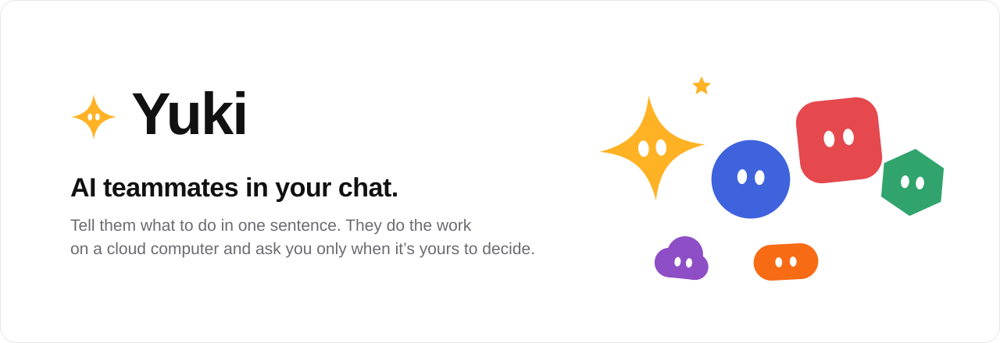
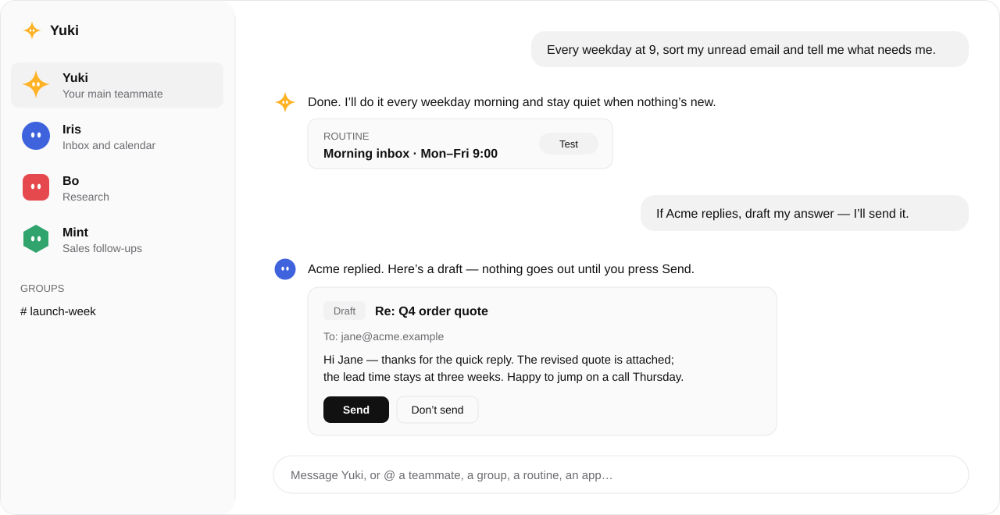

<picture>
  <source media="(prefers-color-scheme: dark)" srcset="assets/banner-dark.svg">
  
</picture>

  <a href="https://yukilab.si"><b>在 yukilab.si 试用</b></a> ·
  <a href="#yuki-能做什么"><b>能做什么</b></a> ·
  <a href="#开源"><b>开源</b></a> ·
  <a href="README.md"><b>English</b></a>

Yuki 是聊天里的 AI 同事。打开就有 Yuki，第一句话告诉它做什么。需要帮手就加成员，拉进群里，它们在对话里互相交接。要登录或要你拍板时才来找你；没有你点头，不会以你的名义发出任何东西。

<picture>
  <source media="(prefers-color-scheme: dark)" srcset="assets/chat-dark.svg">
  
</picture>

## Yuki 能做什么

<table>
<tr>
<td width="50%" valign="top">

**说话就行，不用配置** 
没有设置表单。第一句话就是成员的职责，想改就跟它说。

</td>
<td width="50%" valign="top">

**成员和群** 
群 2 到 6 个成员。`@` 可以指成员、群、例行、应用。交接在对话里，看得见。

</td>
</tr>
<tr>
<td valign="top">

**例行** 
「每个工作日 9 点……」「来信时……」。在成员卡上暂停、测试、修改。没有新情况就安静。

</td>
<td valign="top">

**技能** 
一句话存下一种做法，或者让 Yuki 从刚和你一起做完的事里学会。

</td>
</tr>
<tr>
<td valign="top">

**应用和 MCP** 
Gmail、谷歌日历、自己的邮箱、Slack，以及任何 MCP 服务。连一次，所有成员都能用。

</td>
<td valign="top">

**要紧的事你来批** 
允许一次、总是允许、拒绝。邮件和 Slack 消息都是草稿，你点发送才发。动作审查按你自己的规则检查每一步。

</td>
</tr>
<tr>
<td valign="top">

**有电脑可用** 
成员在云电脑上用真浏览器干活。实时预览随时看，网站要你时接手，做完交还。

</td>
<td valign="top">

**数据在你自己手里** 
对话存在你自己的数据库里。密钥用你自己的钥匙加密，模型永远看不到。

</td>
</tr>
</table>

## 开源

Yuki 的单用户核心（上面这些功能，一个人在自己的服务器上用）正在准备开源，会以 MIT 许可证发布在这个仓库。点 Star 或 Watch，发布时会通知你。

|  | 开源核心（即将发布在这里） | [托管版](https://yukilab.si) |
|:--|:--|:--|
| 聊天、成员、群、例行、技能、应用、审批 | ✓ | ✓ |
| 电脑 | 你自己的电脑 | 云电脑 |
| 团队、共享空间、计费 | — | ✓ |

## 出处

Yuki 起源于 CopilotKit 的 [OpenMuse](https://github.com/CopilotKit/openmuse)（MIT）。
